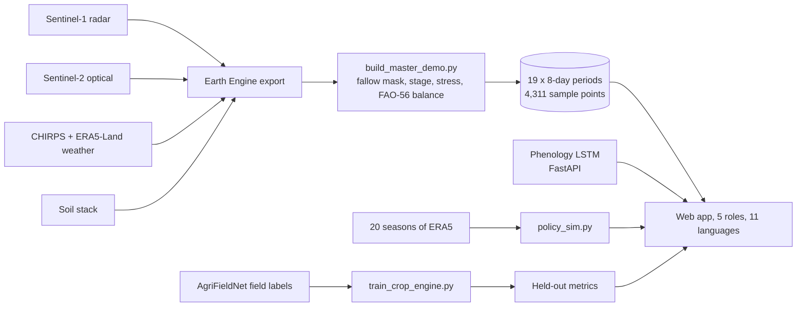

# AgriSense

Satellite-based crop water advisory for canal-irrigated farms in Karnal, Haryana.

**Live demo:** [agrisenseirrigation.netlify.app](https://agrisenseirrigation.netlify.app/)

## Problem

Canal water in Karnal reaches farmers on a fixed rotation, whatever each crop needs that week. Head-end farmers can overdraw while tail-end farmers run short, and monsoon cloud hides crops from optical satellites when decisions matter. AgriSense combines Sentinel-1 radar, Sentinel-2 optical imagery, weather and soil data into an 8-day water balance, then gives farmers, water user associations and irrigation officers an advisory in their own language.

## One argument, four parts

| Part | Job in the argument | Where |
| --- | --- | --- |
| Karnal operational demo | The product | [`index.html`](index.html) |
| Haridwar cloud-gap study | Radar matters under monsoon cloud | [`haridwar.html`](haridwar.html) |
| AgriFieldNet study | The crop model works on real labels | [`agrifieldnet.html`](agrifieldnet.html) |
| Policy simulator | The impact number | "Policy Simulator" button on the demo |

Appendix: [US soil-moisture research](soil-moisture.html), a separate historical study. It is not part of the Karnal advisory.

## Architecture



## Results

| Result | Value | What it is |
| --- | --- | --- |
| Crop model, study leader | Macro-F1 0.391, accuracy 73.3% | AgriFieldNet real labels, 5,551 fields, 13 classes, 4 spatial folds. Majority-class baseline: 0.041 / 36.6% |
| Crop engine, bands shared with Karnal | Macro-F1 0.368, accuracy 72.7% | Same folds, Random Forest |
| Cloud-gap result | Macro-F1 0.424 radar + optical, 0.267 optical alone | Haridwar wheat phenology at 60% optical masking |
| Phenology LSTM | Accuracy 80.9%, 5 classes | Unseen fields, but labels are derived from NDVI trajectories |
| Policy simulator | 15% less water, +11 points relative yield, 54% fewer tail-end stress days than a fixed schedule | **Simulation**: 20 wheat seasons at 70% of unconstrained demand. Not measured field savings |

### Known limits

- The Karnal crop layer shows a derived "kharif crop, type unverified" label. The crop engine is trained on Nov–May and the Karnal table covers Jun–Oct, so it needs a Karnal Nov–May export before it can run there.
- The 4,311 map points are random Earth Engine sample pixels, not farm parcels.
- Stress is relative: NDMI scaled within the p10–p90 range for the growth stage across Karnal's sample points. It has not been validated against field measurements.
- The 8-day advisory has no soil-water carry-over, so it can over-advise right after heavy rain. The policy simulator does carry soil water over.
- Simulated savings depend on the assumed farmer schedule: the FAO-56 rule saves 38% against five irrigations, 23% against four and uses 3% more against three. The panel shows the full table.

## Run it

```bash
npm install
npm start                # http://localhost:3000, also starts the inference service
npm test
```

Rebuild data (Python 3.11+, `pip install -r pipeline/requirements_master_demo.txt`):

```bash
python pipeline/build_master_demo.py     # Needs the weather and soil GeoTIFFs in data/
python pipeline/train_crop_engine.py     # Writes models/crop_engine_agrifieldnet.joblib
python pipeline/policy_sim.py --fetch    # Downloads ERA5 weather, writes data/policy_sim/
```

Before a live demo, wake the Render backend and check both endpoints. The first request can take about 30 seconds.

```bash
curl https://agrisenseirrigation.netlify.app/api/health
curl https://agrisenseirrigation.netlify.app/api/inference/health
```

## Repository layout

| Path | Contents |
| --- | --- |
| Root | The four site pages (`index`, `haridwar`, `agrifieldnet`, `soil-moisture`), `server.js` and deploy config |
| `css/`, `js/` | Site styles and scripts. The site is served as-is from the root by Netlify |
| `scripts/` | Windows launcher for the web app and inference service |
| `pipeline/` | Data builds, model training, simulator, inference API |
| `data/` | Site data, source tables and study outputs |
| `models/` | Phenology LSTM. `models/rule_consistency/` keeps the retired circular-label models |
| `AgriFieldNet/`, `notebooks/` | Study inputs, outputs and notebooks |
| `patches/` | One-off patch scripts kept for reference |
| `docs/` | Integration notes and reports |
| `tests/` | Data, language and dashboard tests |

## Team

Atharva R Naik
